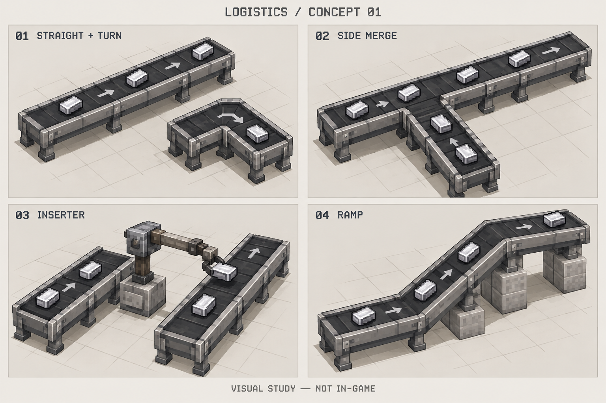

# 独立物流模组开发与美术评审

日期：2026-10-31。阶段：架构建议与第一轮美术探索。尚未创建模组工程，尚未实现或测试游戏功能。

建议采用独立模组，在本仓库新增 `mods/logistics/` 维护。目录名是工作名，正式名称与 mod ID 待定。独立输出 JAR，使用当前整合包锁定的 Minecraft、NeoForge 与 Java 版本；基础运行不依赖 IC2。原版容器、生电收集装置和 IC2 是首批使用场景。通过标准按面库存接口接入，特定模组的特殊能力放在可选适配层。

传送带、机械臂、路径铺设、物品保存和客户端动画都属于自身逻辑，不适合继续增加 IC2 的维护范围。独立模组可以分别构建、测试、升级，也能在没有 IC2 的环境中运行。先保留在同一仓库，复用维护习惯与测试环境；不必为了独立 JAR 另建仓库。正式开发时再给统一 `./dev` 工具增加入口，本轮不修改构建配置。

保留[评估文档](../../conveyor-feasibility.md)中的已确认规则：主干优先，侧带只补汇入口空位；机械臂按周期进行带间搬运；不提供同层互不混合的交叉通道。图中装饰、间距和颜色不增加新的玩法约束。既有 IC2 分拣机保持原有语义。

可以先评审美术。适合的顺序是概念图、尺寸模型草稿、最小游戏原型、正式资源与完整功能。概念图先确定风格，模型草稿再确定占地和活动范围；最终资源应在游戏视角下复核。这样可以先 review 外观，同时避免在抓取距离、坡道尺寸尚未确定时批量制作资产。

| 阶段 | 产物 | 评审或验证重点 |
| --- | --- | --- |
| 1. 美术概念 | 当前四格概念图 | 原版环境与 IC2 环境是否协调；设备厚重程度；货物和方向是否清楚 |
| 2. 尺寸与动作草稿 | 带格点的俯视、侧视图，可编辑粗模型，分拣器动作分镜 | 带面高度、碰撞范围、两条带间距、机械臂底座位置、抓取与放置范围；近邻两条带是否需要额外底座空间 |
| 3. 最小可玩原型 | 独立模组骨架、手动铺带、箱子与熔炉、主干优先汇入、带间机械臂 | 守恒、堵塞、方向、动作与实际搬运是否一致；先用已评审的简单模型 |
| 4. 正式资源与交互 | 定稿模型、像素贴图、物品图标、动画、铺设预览 | 第一人称与远距离可读性；连续铺设接缝；取放点；坡道与周围方块关系 |
| 5. 兼容与交付 | 原版独立环境、IC2 环境和整合环境测试，独立 JAR | 按面容器限制、多人、拆装、区块停运恢复、实际保存关闭重启、性能与最终产物一致性 |

当前概念图采用铁框、深色胶带、清楚的箭头和简洁方块机械臂。这是第一版提案，不是已批准的风格。重点是能融入原版与 IC2，同时在带上有物品时仍能识别方向。

四格分别展示直线与转弯、T 形侧向汇入、平行带间机械臂和升降坡道。这是一张生成的美术概念图，不是游戏截图或可直接加载的贴图。静态图无法证明主干优先、机械臂周期或物品守恒。图中支脚间距、坡道跨越长度、机械臂底座及抓取跨度没有按实际方块坐标校准，必须在第二阶段重新确定；不将图中的多个支脚解释为每格必须独立放置的结构。

第一轮评审重点是整体工业风格、传送带是否过厚、机械臂是否过大，以及箭头和货物是否足够清楚。连接细节和精确尺寸留到模型草稿评审。正式资产清单至少包括直线、转弯、坡道及过渡连接、汇入边缘、机械臂底座与活动关节、抓手、物品图标和铺设预览材质。每项保留可编辑源文件及导出资源，指定旋转轴、取放点、贴图分辨率与动画阶段。像素密度先以 16 像素每方块作为草稿基准，有必要时再评估 32 像素方案，不用高分辨率概念图替代像素贴图。

源码实现时区分物流状态、方块与库存接入、客户端渲染与输入、可选适配。服务器决定搬运与放置结果，客户端播放动画并展示预览。机械臂手中物品是否真实保存、冷却时序、两侧带同时争抢空位等问题仍按评估文档的待定项处理，不由美术自行决定。

本图使用内置 imagegen 工具生成，完整提示词保存在 [concept-01-prompt.txt](concept-01-prompt.txt)。本轮只新增评审资料并更新维护索引，未变更源码、模组版本、交付清单或存档。验证限于图片人工检查、文件与本地链接存在性和差异格式检查；未运行构建与游戏测试。
