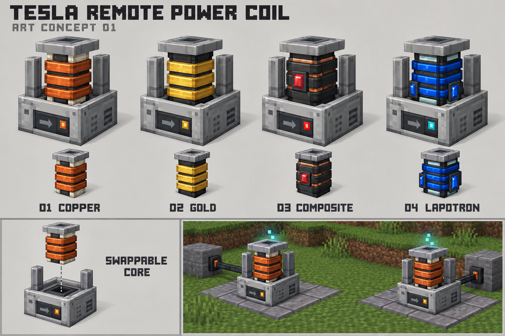

# 特斯拉远程输电线圈美术概念 v1

日期：2026-10-31。状态：首版造型提案，等待用户评议。使用内置 image_gen 生成；未制作可加载的方块模型、物品贴图、动画或游戏注册。

## 造型方向

沿用[玩法设计草案](../../wireless-power.md)的通用本体与可更换内核结构。浅灰铁质机座、深色前面板、侧面固定柱和方形线圈形成共同轮廓。图中从左到右是铜绕组、金绕组、复合绕组和兰波顿谐振内核。颜色与外露材料用于识别候选等级，不表示四级配方或数值已经定稿。

下方独立内核用于讨论物品轮廓；左下展示空机座与插入方向；右下是生成的场景示意，不是游戏截图。两台设备只连接各自附近的短导线，端点附近显示少量工作粒子。

## 建模时需要落实

- 本轮提出单格占地、全模型收进一个方块体积的目标，尚待用户确认。概念图的透视和比例不能充当尺寸验收；后续需在 0–16 模型坐标内明确机座、固定柱与内核尺寸。
- 实际生成图采用三道主要绕组，原提示词要求四道。当前保留三道作为可读性较好的视觉候选，不把提示词当作已落实的几何规格。
- 机座在四级之间保持一致。内核是完整可拆部件，包含绕组、绝缘、顶部谐振帽及高等级水晶。
- 前面板箭头、状态灯的发送／接收、停机／工作表现仍需分别设计。场景中两台机器的箭头没有形成经过验证的角色对应，不作为 UI 规范。
- 正式像素纹理需按选定分辨率重新制作，并检查近邻采样与游戏光照；本图不能直接当作 UV 图集或精确物品精灵表。
- 工作效果仅在端点附近出现；本图没有定义粒子数量、动画周期、发光渲染或声音。

## 文件与检查

- [概念板 PNG](concept-board.png)，1536 × 1024。
- [完整生成提示词](prompt.txt)，记录本次内置工具输入。

已目视检查四级对应、共用机座、独立内核、拆装示意及场景构图。图片保留生成原文件，未裁切或改绘。只执行文件、图片尺寸及文档静态检查，没有执行游戏构建或客户端验收。其他会话正在修改的物流美术资源不属于本轮范围。
